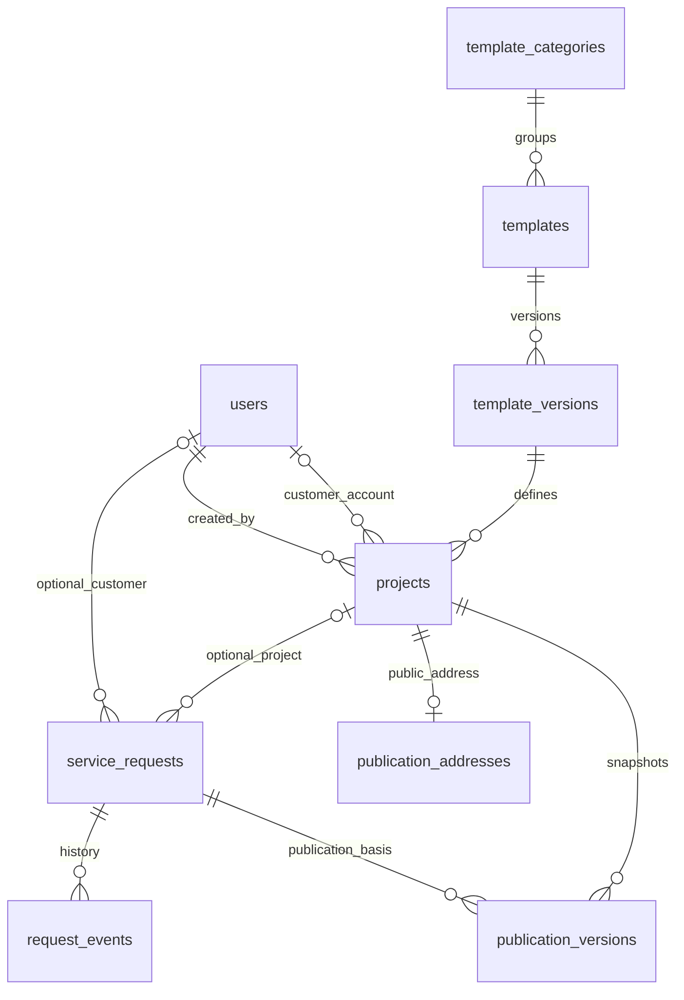
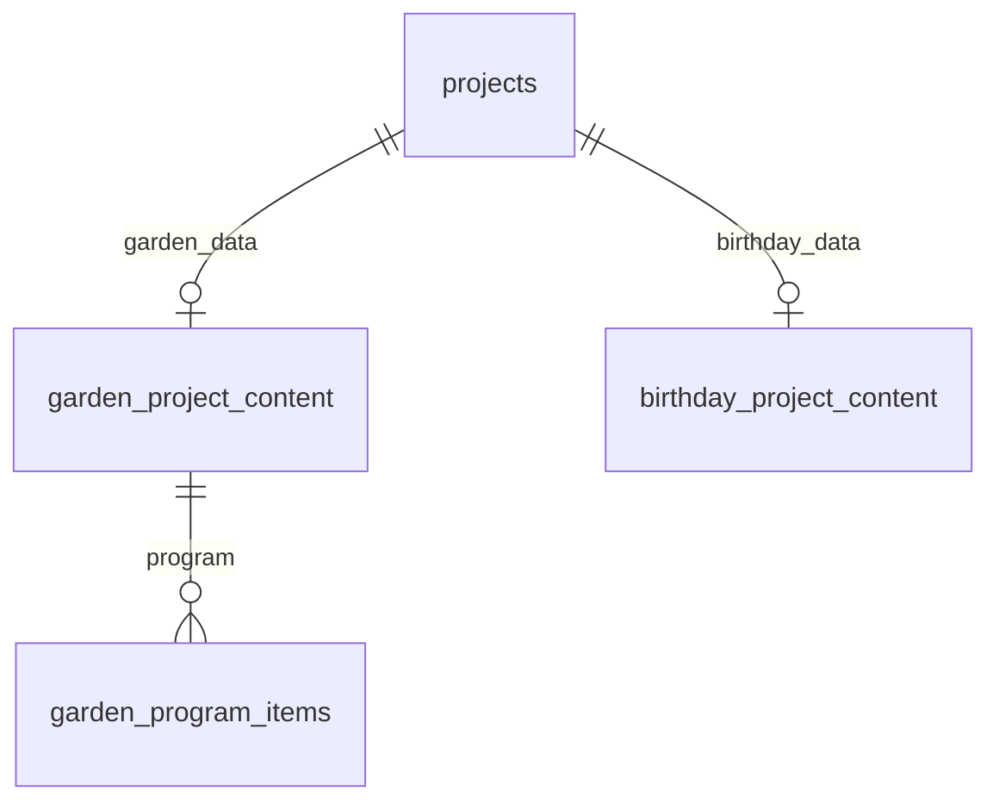

# Модель данных MVP v2 и типизированные шаблоны

20.11.2026. D-40 выбирает JSONB со строгой версионированной схемой; D-41 разрешает гостевую общую заявку и уточняет admin экран. Таблицы/миграции ниже пока **проектируются**. [Продукт](../product/mvp-v2.md), [система и API](assisted-publication.md), [эволюция схем](template-schema-evolution.md). Фактическая БД до изменений — [Prisma](../../apps/api/prisma/schema.prisma) и E2-02; requests/templates/publications/roles ещё нет.

## Типизация и хранение — разные уровни

| Уровень | JSONB + конкретная схема | Отдельные таблицы шаблонов |
| --- | --- | --- |
| Форма React Hook Form | useForm&lt;GardenContentDto&gt;, имена/типы полей конкретного шаблона | Такой же конкретный тип |
| Backend | Garden DTO, class-validator/whitelist/nested validation в runtime | Те же DTO/валидация, плюс SQL ограничения колонок |
| API | OpenAPI → Orval, одинаково строгие контракты | Тот же способ |
| PostgreSQL | JSONB проверяет представимость JSON, не прикладную Garden-схему; связи/квоты в колонках | Типы/NOT NULL/CHECK/FK специфического payload выражены SQL |

Структура версии Garden всегда одна; optional-блок — заранее описанное nullable-поле, а не произвольный объект. Не принимаем any/Record произвольных пользовательских ключей. Текущие GardenContentDto/SaveProjectDraftDto уже типизированы и валидируются; сырые Prisma JsonValue не передаются напрямую UI.

Для нескольких шаблонов нужен явный тип по идентификатору версии, а не один интерфейс со всеми optional-полями. Эскиз будущего контракта, **BirthdayContentDto пока не существует**:

```ts
type EditorModel =
  | { templateVersionId: "wedding-garden-v1"; content: GardenContentDto }
  | { templateVersionId: "birthday-celebration-v1"; content: BirthdayContentDto };
```

Версия выбирает конкретный RHF editor и Nest DTO/validator. OpenAPI должен описывать конкретные варианты (например oneOf/discriminator); результат Orval проверить typecheck и контрактными тестами до обещания нужного union. Модель хранения на frontend не импортируется: форма получает валидированный конкретный DTO и поля с автодополнением. JSONB не заставляет делать форму неограниченным JSON-редактором.

Проверенные 20.11.2026 первичные источники: [TypeScript discriminated unions](https://www.typescriptlang.org/docs/handbook/2/narrowing.html#discriminated-unions), [Swagger oneOf/discriminator](https://swagger.io/docs/specification/v3_0/data-models/inheritance-and-polymorphism/). Они описывают механизм, не доказывают, что будущий contract уже создан в нашем OpenAPI.

Метаданные формы/renderer ссылаются на зарегистрированные в коде ключи. Если admin создаёт карточку с неизвестным renderer/schema version, её нельзя показывать как готовый к заказу шаблон. Новая анимация и новое семейство формы требуют разработки/проверок; это отдельная работа от быстрого заполнения проекта оператором.

Официальная документация: [JSONB и индексы PostgreSQL 17](https://www.postgresql.org/docs/17/datatype-json.html), [ограничения/FK/CHECK](https://www.postgresql.org/docs/17/ddl-constraints.html), проверено 20.11.2026. Q-23 закрыт: выбран JSONB. SQL-сравнение ниже сохранено как обоснование, не альтернативная задача миграции.

## Независимая от хранения предметная модель



Гостевая общая заявка разрешена D-41: customerUserId может отсутствовать. Владение созданным admin проектом и передача кабинета/ответов — ещё Q-25. Заявка на публикацию содержит projectId сразу, общая получает его после подготовки. Число одновременно открытых заявок — Q-28. Наличие snapshots не означает новую бесплатную публикацию или автоматические 90 дней после снятия.

| Предлагаемая сущность | Ключевые поля | Назначение / открытое |
| --- | --- | --- |
| User | Существующие поля + роль/набор прав | Admin/customer; способ хранения роли технически выбрать в задаче, выдачу закрыть от публичных DTO |
| TemplateCategory | id, slug unique, title/locale labels, visibility/order | Событие, а не визуальная палитра. Конкретный начальный список админки ещё утвердить |
| Template | id, slug unique, categoryId FK, title, description, previewAsset, priceMinor, currency, priceVersion, active | Фиксированная цена шаблона; целые минимальные денежные единицы, не JS float. Фактические суммы Q-27 |
| TemplateVersion | id, templateId FK, schemaVersion, rendererKey, defaultsVersion, status | Неизменяемый контракт формы/рендера. Код не исполняется из строки БД |
| Project | id, customerUserId?, createdByUserId, templateVersionId FK, revision, title, editable state, timestamps, source request linkage | Данные, владельца и creator не смешивать. Текущие ownerId/revision/key hashes сохранять/переименовывать только отдельной совместимой миграцией |
| ServiceRequest | id, kind, projectId?, customerUserId?, contactName, phone, contactChannel, contactValue, status, assigneeId?, requestVersion, submittedRevision?, price snapshot?, createdAt/updatedAt | Самостоятельно заполненный проект или помощь с нуля; контакты не публичны. Общая заявка без регистрации D-41; nullable/обязательность по kind, Q-25/27/28 |
| RequestEvent | id, requestId FK, actorId?, action, from/to state, createdAt, безопасные details | Аудит оператора, а не копия телефонных переписок/секретов/полного body |
| PublicationVersion | id, projectId FK, requestId FK, sourceRevision, templateVersionId, snapshot, publishedBy, createdAt | Конкретная одобренная версия, независимо от дальнейшего editable payload |
| PublicationAddress | id, projectId FK unique, normalizedSlug unique, state, createdAt | Назначает admin; собственный hostname клиента и reuse адресов пока Q-31/20 |
| PublicationPeriod | id, project/publication linkage, granted duration, start/remaining/pause fields | Отдельно от статуса заявки; политика платного срока Q-26/29 |

MediaAsset, RSVP form/response и jobs остаются последующими сущностями из прежнего плана. JSONB выбран D-40; точные новые role/category/request/nullable-связи здесь ещё не применённая Prisma schema.

## Выбранный вариант · JSONB для контента

Projects сохраняют конкретный payload версии; TemplateVersion выбирает валидатор и renderer. Категории, цены, права, заявки, связи, периоды и адреса — реляционные таблицы. Добавление оформления не требует отдельной таблицы контента, но требует DTO/renderer/tests. Поисковые индексы JSONB добавляются только при запросе, которому они нужны.

Выбран владельцем D-40. Используем конкретный контракт версии для формы/валидатора/рендера; миграция ключей JSON при переносе существующих проектов выполняется явно по [политике](template-schema-evolution.md). Массового преобразования этой задачей не выполнялось.

## Историческое сравнение · SQL subtype не выбран



garden_project_content содержит projectId PK/FK, имена, дату/время/пояс, место/адрес, поля copy и выбранное медиа; повторяющаяся программа — дочерние rows. birthday_project_content имеет собственные поля. Строка — контент **одного проекта**, а не общий Garden для всех пользователей. У необязательных полей явные nullable/блок flags; ограничения draft/full всё равно различаются, нельзя сделать обязательное для publish поле NOT NULL так, чтобы пустой draft стал несохраняемым.

Плюсы сравнивавшегося варианта: прикладные SQL-типы/ограничения и обычные запросы по полям. Цена: миграции/Prisma models/маппинг на каждое семейство и эволюцию, контроль соответствия version/content subtype. Одного FK projectId для этой согласованности недостаточно. Вариант не выбран D-40, таблицы subtype не планировать как обязательную миграцию.

Не рекомендуются произвольная таблица key/value на каждое поле, один any DTO для всех шаблонов, SQL-таблица с именем из пользовательского ввода или автогенерация DDL администратором.

## Версии, цена и право публикации

Цена категории не подменяет цену шаблона. Старый согласованный заказ не должен незаметно получить изменённую каталоговую цену; момент фиксации/изменения — Q-27. Текст/фото/анкета в snapshot должны соответствовать проверенной оператором версии, а не изменённому в другой вкладке draft — Q-28 и expectedRevision.

Project.status недостаточно, чтобы определить опубликованные данные: при редактировании/повторной подготовке опубликованный snapshot должен оставаться отдельным объектом. Заявка не равна оплате и не равна публикации. URL связан с публикацией/проектом, а контакты остаются в ServiceRequest. Срок хранения contact request отличается от срока публикации приглашения и срока хранения RSVP; Q-10/19 пересмотреть для новых контактных полей.
