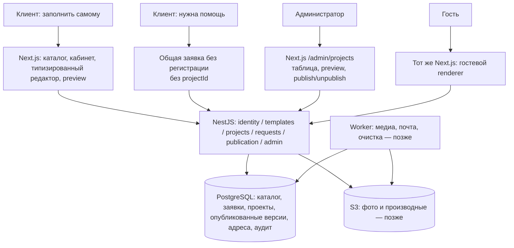

# Архитектура MVP v2 · Публикация через администратора

**D-42/43 приоритетнее прежних формулировок ниже:** admin создаёт проект из готового шаблона для заказа без аккаунта; редактор доступен при открытой заявке и после unpublish, в published блокируются все поля. Live snapshot меняется только атомарной admin-публикацией просмотренной revision. [Допущения](../product/implementation-assumptions.md).

Фактический E2-04 использует `POST /api/v1/admin/requests/{id}/publish` и фиксирует адрес, снимок, первую дату публикации, срок, версию анкеты и квитанцию в одном commit. Снятие и повторное размещение относятся к E4-01. [Контракт, таблицы и проверка](../product/e2-04-admin-publication.md).

20.11.2026. Подтверждённый продукт: [MVP v2](../product/mvp-v2.md), D-38/39. Ниже **проектирование для ревью**, не реализованный API/DDL. Исходная реализация по main 3626e47: identity, каталог без цен/категорий, Garden DTO/renderer и private draft API E2-02. Роли admin, заявки и реальная публикация пока не созданы.

Уточнения D-40/41: JSONB и версии схем выбраны, общая заявка доступна без регистрации. Минимальный admin интерфейс — приватная таблица проектов с templateId, пользователем, названием и publish/unpublish; очередь/контакты доступны из связанной заявки. [Эволюция полей](template-schema-evolution.md).

## Границы системы

Сохраняются один web и модульный монолит NestJS. Новый requests-модуль хранит заявки; admin — проверенные операторские use cases и доступ, а не второй backend. Identity выдаёт проверенного actor с актуальной ролью; регистрация не принимает role/owner/admin flags. В будущем admin нельзя назначать через публичную форму, а отзыв роли должен прекращать новые действия с текущей сессией. Конкретный bootstrap admin — отдельная задача, не изменение учётных записей сейчас.

Next.js строит формы на React Hook Form с конкретным типом версии шаблона. Backend class-validator/DTO проверяет тот же API-контракт в runtime. Orval генерирует frontend-типы/методы/hooks. HTML/JS/анимации хранятся в code-owned renderer; пользовательские тексты/фото — данные. Нельзя исполнять скрипты из формы или JSONB. Админка для быстрого создания проекта использует ту же форму/preview; произвольный no-code редактор нового дизайна не входит в порученный scope (уточнение D-41).

## Права и защита данных

| Действие | Клиент | Администратор | Без входа |
| --- | --- | --- | --- |
| Каталог/демо/прайс | Да | Да | Да |
| Создать/сохранить свой черновик | Да | Да, отдельный операторский use case | Нет |
| Private preview | Свой проект | Проект по доступной заявке | Отдельная безопасная схема не принята |
| Отправить заявку с projectId | Только свой проект, session/CSRF | Может вести операторскую заявку | Нет |
| Заявка без projectId | Да | Обработка | Да, D-41 |
| Очередь/контакты заявок | Только собственный безопасный статус, состав Q-25 | Да, по разрешению | Нет |
| Назначить домен / publish / resume | Нет | Да, после серверных проверок | Нет |
| Снять с публикации | Прямое действие не подтверждено | Да, D-41, с аудитом | Нет |
| Полное редактирование после снятия | Q-29 | Q-29 в части разрешённых изменений | Нет |

Права admin проверяются на сервере, скрытая кнопка не защита. Обычные owner routes E2-02 не получают универсальный bypass: admin-доступ оформляется отдельными маршрутами/use cases с actorId/reason/audit. У проекта без клиентского аккаунта доступ администратора следует из заявки и роли; не создавать поддельный email/User ради обязательного FK. Точная привязка к будущему аккаунту — Q-25.

Контакты — данные заявки с ограниченным доступом; не включать их в публичный snapshot, slug, Open Graph, логи, session payload или браузерную аналитику. Telegram/MAX/VK пока обозначают ручной способ связи, не обязательство подключать OAuth/bot API или автоматически отправлять сообщение.

## Состояния и фиксация версии

Нельзя объединять статус проекта, статус заявки, видимость публикации и расход периода одним флагом. Предлагаемые состояния заявки: new → in_progress → ready → fulfilled; ответвления needs_changes / rejected / cancelled. Это предложение Q-28, не принятый enum или новый endpoint.

Проект хранит editable revision; заявка должна указывать ревизию/версию шаблона, согласуемые данные и предложение цены. Публикация создаёт независимый проверенный snapshot. Если черновик менялся во время общения, admin видит рассогласование и повторно смотрит актуальный preview. Нельзя автоматически публиковать «последнюю запись», которую оператор не проверял. Выбор freeze редактора против фиксированной submission-версии — Q-28; согласовать до реализации заявок.

## Предлагаемый контракт для проектирования

Это **новые проектируемые маршруты**, OpenAPI приложения остаётся фактическим 0.9.0 до следующей реализации. Не генерировать клиент по этому Markdown вручную.

| Операция | Содержимое / эффект | Проверки / ошибки |
| --- | --- | --- |
| GET /templates | Категория, цена/валюта/priceVersion, demo, templateVersion; отдельный список категорий | Не выдавать неготовый renderer за доступный; конкретные суммы ещё не приняты |
| POST /publication-requests | projectId, expectedRevision, имя, телефон, channel, contactValue, expectedPriceVersion | Session/CSRF/owner; 404 чужой, 409 revision/цена/активная заявка по выбранной политике, 422 поля |
| POST /service-requests | Публичная общая заявка, projectId отсутствует; контакты и необязательные пожелания/шаблон | Без регистрации D-41; rate limit/idempotency/contact validation до реализации; статус не равен publication |
| GET /admin/projects | Доступные оператору проекты: projectId, templateId, клиент/отметка без аккаунта, title, статус/URL и доступные actions | Session + admin; no-store, pagination; приватные контакты только в разрешённой карточке заявки |
| GET /admin/requests и /{id} | Доступная очередь и подробности/контакты | Session + admin; no-store, pagination, без публичной выдачи по предсказуемому ID |
| POST /admin/requests/{id}/project | templateVersionId и типизированные данные формы | Admin, заявка, идемпотентность создания, связь request/project атомарна |
| POST /admin/requests/{id}/publish | expectedRequestVersion, expectedProjectRevision, slug/домен в принятом формате, key | Admin + CSRF; owner/client не может выполнить. Форма RSVP/медиа готовы, данные/цена/срок согласованы, адрес уникален |
| POST /admin/projects/{id}/unpublish | expectedPublicationVersion/stateVersion, key; режим расхода по принятой политике | Admin + CSRF; атомарно закрывает публичный доступ/новый RSVP, запись/audit сохраняются. Повтор не удаляет данные и не выдаёт новый срок; детали Q-29 |

POST service-request и publication-request могут быть одним доменным requests service с двумя явными HTTP-контрактами; окончательный выбор до API PR. Не разрешать клиенту выбрать чужой projectId или назначить себе admin/assignee/approved/price/period. Суммы/сроки берутся из доверенной политики, не из пользовательского body. Публичный успех заявки не отдаёт контакты других заявок; правила чтения своей заявки — Q-25.

## Транзакция admin publish

1. Проверить сессию, роль и CSRF; загрузить заявку/проект и проверить допустимость действия.
2. В установленном порядке блокировать связанные ресурсы; для обычных owner-проектов сохранить порядок owner → project. Для admin-assisted без owner нужна общая стратегия request → project, согласованная до миграции Q-25. Два admin не должны фиксировать одну заявку дважды.
3. Проверить конкретную ревизию, типизированную полноту, ready/ownership медиа, версию анкеты, согласованную цену и срок. Для заявки без projectId публикация невозможна, пока проект не создан и не связан.
4. Атомарно зарезервировать уникальный адрес, записать snapshot/период/receipt, связать публикацию с заявкой и зафиксировать actor/audit. 409 адреса/ревизии не создаёт ложный fulfilled и не расходует новый период.
5. Вернуть публичный URL после commit. Повтор того же key/body даёт прежний результат; иной admin или иной key не создают дубликат уже выполненного заказа.

Согласование в мессенджере, доставка письма, S3 и обработка фото не выполняются внутри SQL-транзакции. Факт ручной передачи ссылки не имитирует отправку сервером. 90 дней D-19 остаются исходным сроком до нового решения; возможные изменения/перепубликация — Q-26/29. Прежний клиентский выбор бесплатного offer больше не часть UX.

## Гостевая и сложное оформление

Сохраняется SSR общего приложения по опубликованному snapshot, анимации — интерактивные островки конкретного renderer. Отдельный Next build на проект не нужен. CSS/JS шаблона версионированы; тяжёлые эффекты не должны блокировать чтение/RSVP, нужны reduced-motion/keyboard/mobile/performance проверки NFR-01–06. Поддомены нашего сервиса — рекомендуемый старт по D-26; индивидуальные домены — Q-31.

Снятие D-41 меняет публичную видимость, а не стирает проект/snapshot/заявку. В таблице показывается «Снят с публикации»; это не автоматический возврат всех прав полного редактирования и не сброс периода. Требование остановить доступ проверяется чтением/RSVP на сервере, не одним скрытием кнопки в UI. Admin-only публикация/снятие остаются будущими use cases; новые endpoints выше пока не реализованы.

E2-02d реализует только роль/GET admin/access/AdminGuard, OpenAPI 0.10.0. [Карточка](../product/e2-02d-admin-access.md). Requests/projects operator routes и публикационная транзакция в таблице выше остаются проектированием, не готовыми endpoints.
