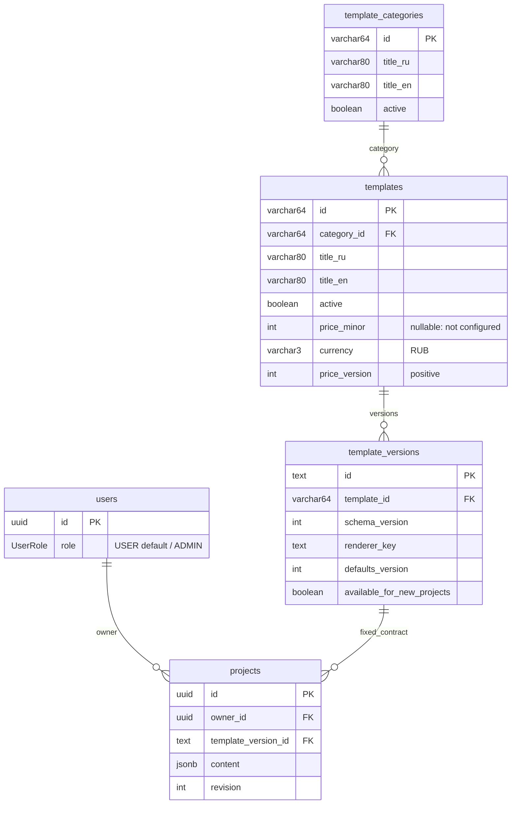

# Реализованный каталог · E2-01d

21.11.2026, ветка feat/template-catalog-data, ещё не main. [Карточка](../product/e2-01d-catalog-data.md), [Prisma](../../apps/api/prisma/schema.prisma), [QA](../qa/e2-01d-catalog-data-report.md). Это фактическая часть v2; ServiceRequest/publication/media/RSVP пока не реализованы.

Старые поля users/projects здесь сокращены; полный исторический снимок main — [current-system](current-system.md), актуальная схема ветки — Prisma. На template_versions есть unique(template_id, schema_version) и SQL partial unique для одной доступной новой версии на шаблон. FK используют RESTRICT при удалении. Добавление FK к projects не переносит/не меняет JSONB, revision, idempotency keys.

DB хранит доступность/названия/категорию/цену; validator/defaults/renderer/пути demo/illustration принадлежат коду. registeredTemplate сверяет id, templateId, schemaVersion, rendererKey и defaultsVersion. Запись незнакомой версии в DB не добавляет исполняемый код и не становится готовой карточкой. Старые поддерживаемые формы продолжают сохраняться при скрытии каталожной записи.

GET каталога анонимен, без cookies/CSRF и private данных, но теперь требует настроенную БД. Health/liveness БД не требует. Categories и versions читаются одним RepeatableRead snapshot. Ключи и фильтр валидируются сервером; frontend проверяет категории/связи/цену/локальные URL перед отображением.

Create сохраняет прежний owner row lock → replay → проверку доступности → квоту → insert. Проверка каталога внутри той же транзакции берёт SHARE lock на category/template/version; изменение доступности ждёт commit. Будущие операционные изменения должны сохранять согласованный порядок блокировок; не добавлять DB/network операции в обратном порядке с owner. Replay прежнего key проверяется до доступности и не становится новым проектом после скрытия.

Версия шаблона не меняется обычным PATCH. JSONB эволюционирует по [D-40](template-schema-evolution.md). Цена versioned integer RUB; null — отсутствие настройки, а не бесплатный пилот. Seed не содержит выдуманной суммы. Честный null-display служит подготовке, **не закрывает Q-27 публичного прайса**. Будущие заявки фиксируют выбранную политику snapshot/согласования отдельно.
