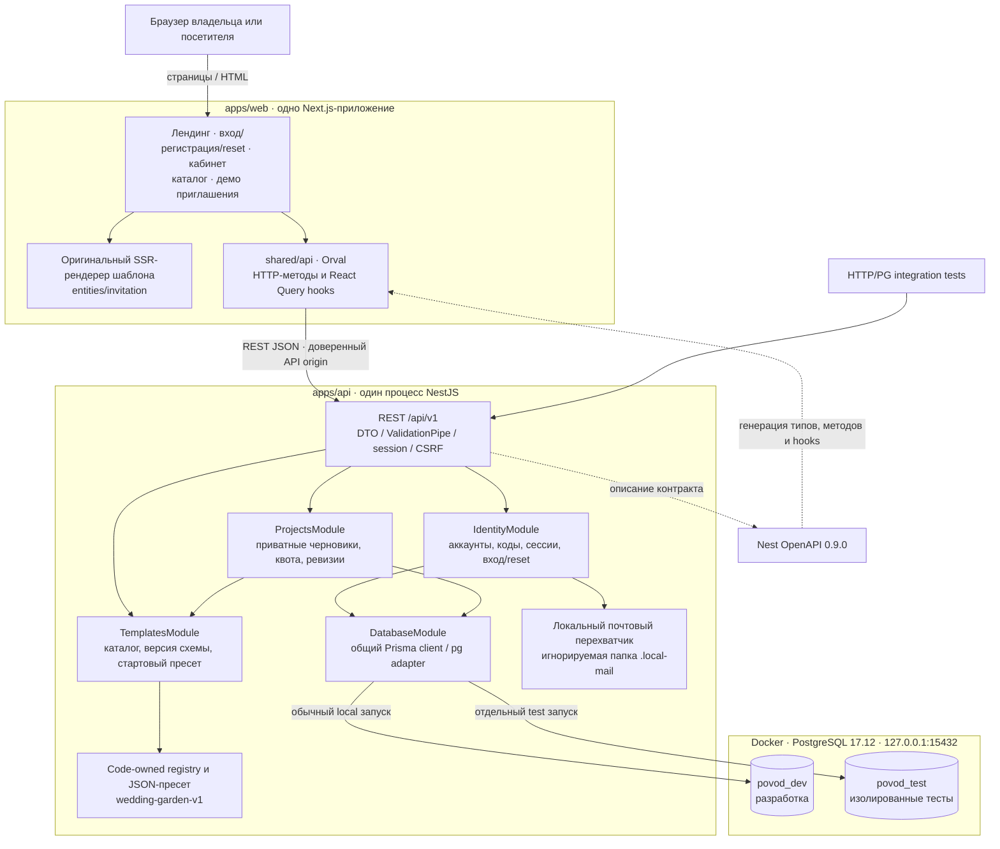
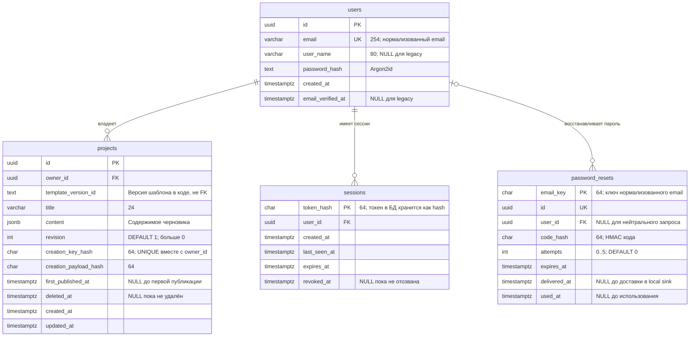
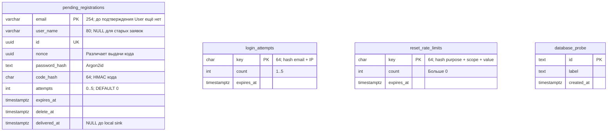
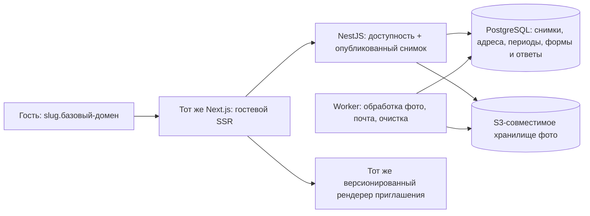

# Текущая архитектура «Повода»

Снимок на 20.11.2026: main **3626e4730dc4c7789f375fc254eb2c5bf0536b12**, после merge E2-02 (b93c865). Это описание реализованного состояния. Будущие компоненты показаны отдельно в конце.

Источники: [Prisma-модель](../../apps/api/prisma/schema.prisma), [SQL-миграции](../../apps/api/prisma/migrations), [AppModule](../../apps/api/src/app.module.ts), [API-контракт](api-contract.md), [локальный PostgreSQL](../../infra/local/compose.yaml). Дополнительно выполнено чтение **только метаданных** локальной dev-БД в read-only транзакции: PostgreSQL 17.12, девять таблиц public, включая служебную таблицу Prisma, 59 колонок. Записи пользователей/коды/пароли/содержимое проектов не читались.

## Система: что работает сейчас



**Модульный монолит** здесь означает один backend с разделением по обязанностям. Identity, templates и projects — модули внутри одного приложения; отдельно их развёртывать сейчас не нужно. Next.js и NestJS — два запускаемых приложения монорепозитория npm workspaces.

Next.js отвечает за страницы/SSR/интерактивный интерфейс, NestJS — за проверку входа, владения, правил и изменения БД. Прямого доступа Next.js к PostgreSQL нет. По умолчанию web работает на 3000, API на 3001; 15432 — порт SQL, не HTTP. Dev и test используют разные базы и роли, а не общие таблицы с test-флагом. Пунктир генерации OpenAPI — шаг разработки, не дополнительный сетевой запрос при каждом действии.

В web готовы identity, каталог и демо. API создания/сохранения проектов и SDK готовы; **UI создания и редактор ещё не реализованы**. Демо рендерится из синтетических данных без API; каталог запрашивает реальные метаданные API. Локальные письма сохраняются в файл, доставки SMTP и отдельного worker пока нет. Сервер выполняет небольшой sweep просроченных заявок регистрации, но полноценная очередь фоновых задач ещё не подключена.

## База: таблицы и связи

В базе восемь таблиц из Prisma-моделей и одна служебная `_prisma_migrations`. Схемы ниже используют **SQL-имена колонок**. В TypeScript `ownerId` соответствует `owner_id`, `userName` — `user_name` и т. п.

Обозначения: **PK** — первичный ключ, **FK** — внешний ключ, **UK** — уникальность. Комментарий `NULL` означает, что значение может отсутствовать. Без такого комментария колонка NOT NULL. `timestamptz` — `timestamp with time zone`; на ER-диаграммах моделей точность 3, API отдаёт даты в ISO UTC. Служебная таблица Prisma описана отдельно.

### Основные сущности



Один пользователь может владеть несколькими проектами и иметь несколько сессий. Проект и сессия всегда ссылаются на одного существующего пользователя. У запроса восстановления `user_id` может быть NULL: ответ снаружи остаётся нейтральным независимо от наличия аккаунта. Поэтому связь с users у password_resets необязательна.

Все три FK настроены с **ON DELETE CASCADE**: физическое удаление User удалит связанные projects/sessions/password_resets. Это свойство DDL, а не реализованная кнопка удаления аккаунта. Мягкое удаление проекта через `deleted_at` не запускает этот каскад; соответствующие операции удаления и purge ещё предстоят.

### Регистрация, ограничения и техническая проверка

У этих таблиц **нет внешних ключей на users**. Размещение рядом на диаграмме не означает SQL-связи.



| Таблица | Для чего существует |
| --- | --- |
| pending_registrations | Email/имя/hash пароля и состояние подтверждения. После верного кода транзакция создаёт User + Session и удаляет заявку; до этого входа и owner-прав нет |
| login_attempts | Счётчик неудачного входа для сочетания email/IP, со сроком окна |
| reset_rate_limits | Лимиты отправки кодов восстановления **и регистрации**, разделённые purpose/scope; название таблицы историческое |
| database_probe | Синтетический технический marker для проверки миграций/seed/изоляции БД; не часть продукта |

### Служебная таблица Prisma

`_prisma_migrations` ведётся Prisma, не бизнес-кодом. Хранит историю применения SQL-миграций, не пользователей.

| Поле | SQL-тип | Nullable | Назначение |
| --- | --- | --- | --- |
| id | varchar(36), PK | Нет | ID записи выполнения |
| checksum | varchar(64) | Нет | Контрольная сумма файла миграции |
| finished_at | timestamptz | Да | Завершение применения |
| migration_name | varchar(255) | Нет | Имя миграции |
| logs | text | Да | Диагностика миграции |
| rolled_back_at | timestamptz | Да | Отметка отката |
| started_at | timestamptz | Нет | Начало применения |
| applied_steps_count | integer | Нет | Выполненные шаги |

Количество таблиц и количество миграций — разные величины: несколько миграций меняют существующую таблицу.

## Индексы и ограничения

PK также создаёт уникальный индекс. Кроме PK сейчас используются:

| Таблица | Дополнительные индексы / уникальность | Для чего |
| --- | --- | --- |
| users | UNIQUE email | Один аккаунт на нормализованный email |
| projects | UNIQUE (owner_id, creation_key_hash) | Повтор создания не создаёт второй проект |
| projects | INDEX (owner_id, deleted_at, first_published_at) | Список владельца / подсчёт его draft-квоты |
| sessions | INDEX user_id; INDEX expires_at | Сессии пользователя и очистка просроченных |
| password_resets | UNIQUE id; INDEX expires_at | Поиск запроса и срок кода |
| pending_registrations | UNIQUE id; INDEX delete_at | Поиск заявки и очистка |
| login_attempts, reset_rate_limits | INDEX expires_at в каждой | Работа со сроком счётчика |

SQL CHECK защищает положительную revision, допустимые attempts/count, порядок времён Session и нормализованный email. Полная схема JSONB/правила владения проверяются NestJS. Лимит пяти черновиков — не CHECK на одной строке: use case блокирует строку владельца и считает проекты в транзакции ReadCommitted. Save требует совпадения expectedRevision; это защищает от потери правок между вкладками.

## Что находится в projects.content

Это **JSONB PostgreSQL** внутри одной строки projects. У каждого шаблона своя версионированная структура, проверяемая сервером. Пример для `wedding-garden-v1` ниже сокращён; copy в настоящем объекте содержит все 14 строк.

```json
{
  "locale": "ru",
  "themeId": "sage",
  "copy": {
    "invitationLabel": "Свадебное приглашение",
    "namesConnector": "&",
    "introduction": "Ждём вас в наш день"
  },
  "names": { "first": "Анна", "second": "Михаил" },
  "event": { "localDate": "2027-06-12", "localTime": "16:00", "timeZone": "Europe/Moscow" },
  "venue": { "name": "Тихий сад", "address": "Самара", "routeUrl": null },
  "program": [{ "time": "16:00", "text": "Сбор гостей" }],
  "heroMediaId": null
}
```

Полный набор copy: invitationLabel, namesConnector, introduction, detailsTitle, whenLabel, whereLabel, startTimeLabel, timeZoneLabel, routeLabel, programEyebrow, programTitle, rsvpEyebrow, rsvpTitle, footerText. [DTO и runtime-валидация](../../apps/api/src/modules/templates/garden/garden-content.dto.ts), [пределы D-37](../product/e2-01-content-schema.md).

Почему так: владельцы, сессии, квоты и связи удобно хранить в реляционных колонках; содержимое разных шаблонов — в конкретном валидируемом JSONB. Не нужна отдельная SQL-колонка на каждую подпись каждого шаблона. Издержка: JSONB сам не гарантирует форму контента; это обеспечивает версия DTO/валидатора. Запросы аналитики по полям контента потребуют отдельного решения, если появится потребитель.

Сейчас нет отдельных таблиц templates или project_drafts. `template_version_id` — идентификатор версии в code-owned registry, не FK в БД; `content` и `revision` текущего черновика находятся непосредственно в projects. `heroMediaId` в JSONB пока не FK; ненулевой ID draft API отклоняет до появления media use case. `first_published_at`/`deleted_at` подготовлены в модели, но publish/delete ещё не реализованы.

Имя аккаунта `users.user_name` до 80 символов и имена события `content.names.first/second` до 20 — разные данные с разными назначениями.

## Как проходит запись черновика

```mermaid
sequenceDiagram
  participant C as Клиент / будущий редактор
  participant A as NestJS
  participant D as PostgreSQL
  C->>A: PATCH project draft + expectedRevision
  A->>A: Session + origin/CSRF + DTO
  A->>D: BEGIN ReadCommitted; lock User
  A->>D: Найти Project по id и owner_id, deleted_at IS NULL
  A->>A: Проверить editable, revision, схему, media reference
  A->>D: UPDATE WHERE revision = expectedRevision; revision + 1
  A->>D: COMMIT
  A-->>C: 200 ProjectDto с новой revision
  Note over C,D: Устаревшая revision → 409, чужой/удалённый Project → 404
```

## Что добавится к первой публикации

Это направление из согласованных документов, **не существующие компоненты/DDL**. Точные таблицы появятся в отдельных миграциях; старую концептуальную ER-схему из first-scenario нельзя считать текущей БД.



Понадобятся данные опубликованных версий, периода/паузы и занятого места, уникального slug, media assets, версии формы RSVP и ответов. Очередь на PostgreSQL согласована, конкретная реализация worker ещё предстоит. SMTP, S3, гостевой host-routing/DNS/TLS и production пока не настроены. Отдельного build Next.js на каждое приглашение не будет: SSR покажет сохранённый опубликованный снимок по адресу, выбранному владельцем. [Поддомены и публикация](publication-addresses.md), [backlog](../product/backlog.md).

## Где смотреть живую схему

Этот Markdown открывается с диаграммами на GitHub. Исходный контракт данных — [schema.prisma](../../apps/api/prisma/schema.prisma); точные SQL CHECK/FK/индексы — [миграции](../../apps/api/prisma/migrations). В WebStorm можно открыть Database → локальную povod_dev → public → Tables и посмотреть диаграмму, если функция доступна в установленной конфигурации IDE. Параметры подключения — [локальный PostgreSQL](../operations/local-postgres.md), секреты остаются в локальном ignored env. Никаких данных аккаунтов для чтения этого обзора не требуется.
