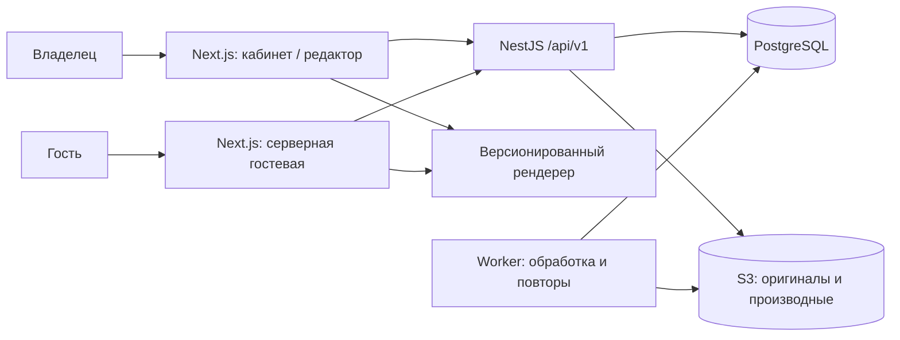
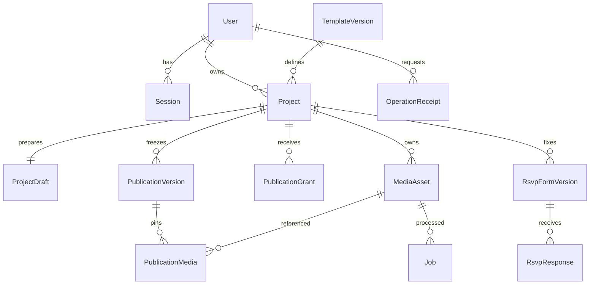

# Первая вертикаль: архитектурное предложение

Статус: для ревью, 10 ноября 2026. Основание: [ТЗ §5–9](../povod-mvp-spec-v0.1.md#9-техническая-архитектура), [решения D-01–13](../product/decisions.md), [сценарии](../product/user-flows.md). Архитектор и UX-дизайнер параллельно вернули предложения без правок файлов; ведущий свёл их. Новые решения ниже — проектные предложения, не утверждённые продуктовые правила.

Объём: один свадебный шаблон «Тихий сад» → приватный черновик → предпросмотр → первая публикация → общая ссылка. Вход email/пароль — предпосылка; после входа нет барьера подтверждения email (D-02). RSVP входит с первой публикации по D-16. Не проектируем платежи, весь admin, экспорт или остальные три шаблона. Пауза предусмотрена в данных и описана для последующего подключения, но не расширяет первую реализацию до полного MVP.

## Компоненты

| Граница | Ответственность и запреты |
| --- | --- |
| Next.js | Каталог, формы, состояния интерфейса, приватный предпросмотр, SSR гостевой. Запрашивает безопасный DTO у API; не считает права, квоты или право публикации самостоятельно. Приватные ответы и HTML `no-store` |
| NestJS | Единственная точка правил владения, ревизий, схемы контента, квоты двух мест, фиксации контента, периода и доступности. REST-контракт — будущий источник OpenAPI/клиента |
| PostgreSQL | Реляционные права/связи/периоды/ревизии, валидируемый JSON контента, идемпотентность и jobs. Не хранит бинарные фото |
| S3 | Закрытые оригиналы и отдельные производные. Ключи не управляются клиентом, оригиналы не публичны. Ограниченный доступ к производным через проверяемую выдачу/короткие URL; точный TTL — Q-09 |
| Worker | Ограниченная по ресурсам проверка/обработка фото, повторы. Позже почта, экспорт и очистка по принятым политикам. Доступность приглашения не зависит от worker/cron |
| packages/templates | Чистые версии схемы/оформления/рендерера, без ORM и приватных полей. Общие имена полей не означают общий доступ к моделям БД |

API кабинета доступен same-origin `/api/v1`; cookie кабинета HttpOnly/Secure, без общего родительского домена гостевых. Изменения требуют CSRF-защиты, проверки сессии и владельца. Запрос чужого projectId возвращает тот же 404, что отсутствующий. Рендер гостевой не использует сессию владельца и не получает email, ownerId, черновик, внутренние причины снятия и приватные S3-ключи.

## Схема сущностей (не DDL)

| Сущность | Основные данные / инвариант |
| --- | --- |
| User / Session | Уникальный нормализованный email, hash пароля, серверная сессия; параметры регистрации/reset — отдельная identity-задача |
| TemplateVersion | Неизменные id/schemaVersion, тип события, разрешённые палитры, обязательные/опциональные блоки и фиксированный порядок; проект не меняет выбранную версию |
| Project | id, ownerId, templateVersionId, внутренний title, publicId после публикации, firstPublishedAt, deletedAt, visibility, расход периода и занятость места как отдельные свойства |
| ProjectDraft | projectId, revision, content, updatedAt. До первой публикации может быть неполным, после — заблокирован |
| PublicationVersion | id, projectId, sourceRevision, templateVersionId, schemaVersion, content, createdAt. Версии immutable; D-17 разрешает новый снимок только для whitelist текстов, остальные данные переносятся неизменными |
| PublicationGrant | id, projectId, снимок длительности/лимитов тарифа, remainingSeconds, runningSince, исходное время выдачи. При будущих новых периодах не переписывать прошлые |
| PublicationMedia | Ссылки снимка на конкретные готовые версии производных; обычная очистка черновика не разрушает опубликованные фото |
| MediaAsset | id, ownerId, projectId, state, privateKey, immutable derivativeVersion, размер/формат, безопасный failureCode |
| OperationReceipt | ownerId, scope, key, requestHash, publicationId/grantId и факт результата; уникальный ключ в scope, не содержит клиентский секрет |
| Job | тип/объект/уникальный ключ, state, attempts, runAfter, lease. Падение worker снимается по lease; повтор не дублирует производные |

## Черновик → опубликованный снимок

1. Создание фиксирует TemplateVersion. Сохранение использует expectedRevision и возвращает новую ревизию; старый запрос не перезаписывает новую. Частичная схема допускает пустые поля, но валидирует типы и запрещённый контент.
2. Предпросмотр запрашивает конкретную сохранённую ревизию, использует общий рендерер. Неполные поля отображаются как явно приватные заглушки с ошибками готовности. Несохранённое состояние не выдаётся за серверный снимок.
3. Перед публикацией UI показывает тариф/пределы, сводку данных, публичность общей ссылки и блокировку изменений. Окончательный expiresAt считает сервер при успешной операции; показанная заранее дата — оценка.
4. NestJS в одной транзакции блокирует сначала владельца, затем проект (единый порядок для всех операций квоты), проверяет ключ/хеш запроса, ревизию, отсутствие первой публикации, версию тарифа, полный контент и готовые принадлежащие проекту фото. Под той же блокировкой захватывает одно из двух мест. Уникальность первой публикации защищает и от другого ключа.
5. В этой же транзакции создаёт снимок, период с настройками на момент выдачи, непредсказуемый publicId и receipt; фиксирует locked/content и slotOccupied. Commit — единственная граница успеха. Рекомендуется publicId с не менее 128 бит случайности, не из email/id владельца.
6. Только после commit возвращается общая ссылка. Нет тяжёлой обработки, писем или внешнего S3-вызова внутри транзакции публикации: выбранные immutable-производные уже готовы. Ошибка до commit оставляет черновик; потеря ответа после commit разрешается повтором того же ключа.

Повтор публикации никогда не означает возобновление или новый период. См. точные [правила повторов API](api-contract.md). После первой публикации draft-редактирование закрыто; отдельная операция текстовых исправлений разрешена D-17, тема/фото/дата/структура/анкета остаются неизменными. Исправление создаёт новый immutable-снимок и атомарно переключает указатель без нового периода/URL.

## Время, ссылка и доступ

Ссылка `/i/{publicId}` не меняется при паузе/возобновлении. Доступна любому получателю, noindex не является защитой. Нужен отдельный origin приглашений, чтобы не передавать auth-cookie кабинета.

`remaining(now) = max(0, remainingSeconds - (runningSince ? now - runningSince : 0))`. Время периода — серверный UTC. Пауза фиксирует остаток и сбрасывает runningSince; возобновление запускает остаток без нового права. Admin без паузы закрывает видимость, но оставляет расход. Владелец вправе сам возобновить (D-08). Пауза занимает место (D-11). Полное истечение освобождает место (D-18), объект удаления определён D-20: пользовательский контент, фото и ответы; окончательная очистка — Q-19; удаление и новая выдача периода проектируются отдельно.

API выдаёт гостевой DTO только если не удалено, видимость открыта, есть снимок и remaining > 0. Cron не требуется для запрета. При сбое БД/API не отдавать старую страницу «на удачу»: 503, а не ложная 404/архив.

Для первого выпуска предлагается SSR и `Cache-Control: no-store` для HTML/публичного DTO. Это строже окна 60 секунд для новой выдачи, но не отзывает уже открытый/скачанный HTML. Постоянный HTML-кеш/OG-кеш/CDN — после замеров и Q-06. Медиа имеют отдельное окно доступа Q-09: no-store HTML не решает отзыв фото.

Дата события хранится как localDate/localTime/IANA timeZone для отображения, без вычисления дедлайнов по событию (D-13). Для первой вертикали не требуется бизнес-UTC события; если понадобится, неоднозначные DST-времена нужно отдельно разрешать. Никаких сравнений с сегодня/окончанием периода. Срок хранения контента не равен remainingSeconds. По D-20 полное истечение запускает мягкое удаление пользовательского контента, фото и ответов; окончательная очистка и бэкапы — Q-19/10.

## Медиа и отказы

Предлагается потоковая multipart-загрузка через NestJS в приватное хранилище, с ограничением входящего размера/таймаута; простой контракт ценой нагрузки на API. Worker декодирует файл с лимитом пикселей/памяти, проверяет сигнатуру, исправляет ориентацию, удаляет метаданные и создаёт WebP/размеры. `ready` — только после записи всех производных; ошибка — `failed`, не «успешно загружено».

Повтор загрузки имеет ключ операции; для замены исходника создаётся новый asset, а не перезапись готовой версии. Удаление/отсоединение разрешено только до публикации, с защитой от гонки с publish. Невыбранные временные объекты можно очищать после подтверждённого срока, но не объекты снимка. Фото необязательно: пользователь может явно убрать неготовый блок либо повторить; сервер не исключает его молча.

## RSVP в первой публикуемой версии

D-16 заменяет прежнее R-01: wedding-garden-v1 уже содержит formDefinition. До публикации схема формы входит в TemplateVersion, при публикации фиксируется RsvpFormVersion и ссылка снимка. FormVersion и поля анкеты нельзя менять через текстовое исправление. Подробные поля — Q-04; проектируемый минимальный вариант: имя, участие, сопровождающие при согласовании лимита.

Добавить RsvpResponse (projectId, publicationId, formVersionId, данные, operationKey) и атомарный предел 300 всех хранимых записей проекта. Имя не уникально, отказ даёт ноль сопровождающих. На паузе ответы сохраняются; при полном истечении приглашение, фото и ответы мягко удаляются по D-20. XLSX owner-only доступен до удаления; экспорт/восстановление после мягкого удаления — Q-19. Окончательная очистка только по согласованной политике.

Схема первой вертикали теперь включает User → Project → FormVersion → RsvpResponse. Все ответы ссылаются на неизменную formVersion; текстовые коррекции приглашения их не переинтерпретируют. Локальный HTML демонстрирует форму на гостевой с первой версии; это не работающий backend.

## Истечение и двухэтапное удаление D-19–21

PublicationGrant выдаётся на 90 × 86400 секунд расхода; пауза не расходует остаток. При remaining=0 проект считается эффективно истёкшим независимо от cron: публичный DTO/новый RSVP запрещены, занятость места false. Обычный resume не даёт новый период. Job отдельно материализует deletedAt/reason=period_expired и мягко удаляет пользовательские снимки/контент, assets и responses согласованной транзакцией/пакетами. Все обычные чтения/экспорты должны проверять эффективное истечение, а не ждать deletedAt от worker.

Удалённые фото не выдаются новыми URL; уже выданные ограничены TTL Q-09. Объекты S3 физически остаются на стадии мягкого удаления. Сохранять ссылки/ключи и журнал состояния до окончательной очистки, не удалять TemplateVersion, общий код рендерера или файлы другого проекта. После принятых Q-19/10 purge-задача удаляет только данные конкретного проекта, повторяема и устойчиво продолжает после сбоя S3/БД. Срок purgeAt сейчас не задан; это не обещание бессрочного хранения. Возврат soft-deleted не реализуется до определения полномочий и нового права публикации. Коррекция текстов после истечения запрещена как обычный доступ к удалённому проекту.
