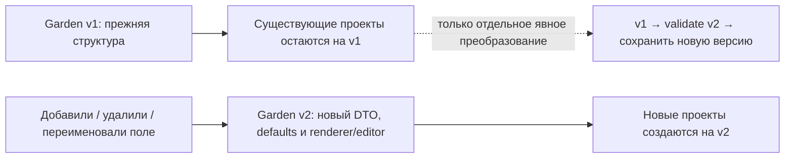

# Эволюция схем шаблонов в JSONB

21.11.2026, D-40. Выбран JSONB + конкретные TypeScript/DTO/runtime-схемы. Это политика проектирования следующих изменений, а не уже созданный механизм массовой миграции. Текущий API 0.9.0 знает только wedding-garden-v1.

## Два разных счётчика

- templateVersionId/schemaVersion определяют **структуру содержимого** и совместимый renderer/editor.
- project.revision — номер **сохранения пользовательских данных**, используемый для защиты от перезаписи. Десятая revision проекта может по-прежнему использовать Garden v1.

Колонка projects.content остаётся JSONB при добавлении/удалении поля внутри него. ALTER TABLE для каждого такого поля не нужен. Но если решаем преобразовать уже сохранённые payload, это всё равно **миграция данных**, которую нужно написать, проверить и выполнить явно. PostgreSQL поддерживает jsonb_set и удаление ключей; автоматического знания нашей DTO-схемы у JSONB нет. [Первичный источник PostgreSQL 17](https://www.postgresql.org/docs/17/functions-json.html), проверено 20.11.2026.

## Обычное изменение поля

| Изменение | Новые проекты | Существующие проекты |
| --- | --- | --- |
| Новое поле | Новая версия схемы, тип и валидатор, осмысленное default/null/пустое draft значение | Старая схема продолжает работать. Если нужно перенести — явный mapper, а не требование неизвестного поля от старого JSON |
| Удалённое поле | Новая версия больше не принимает/не показывает поле | V1 данные и renderer/editor сохраняются. В V2 поле удаляется только при явном переходе, не массовым незаметным UPDATE |
| Переименование/изменение типа | Новая схема и конкретное преобразование | Не читать прежнее имя/тип как новый без проверки; исходные данные должны оставаться восстанавливаемыми по плану отката |
| Изменение стартового текста | Новые defaults для будущих проектов | Авторский сохранённый текст не перезаписывается новым пресетом |

Например, добавление условного поля greetingNote к Garden v2 не означает, что редактор v1 начинает требовать его у старого проекта. Это учебный пример, не новое поле MVP. Backend выбирает конкретный валидатор по версии, OpenAPI/Orval дают соответствующий тип, UI — конкретную форму с автодополнением.

Версия контракта неизменяема. Старые валидаторы/renderer/editor нужно поддерживать, пока на них ссылаются хранимые проекты или опубликованные версии. Нельзя переименовать один GardenContentDto и считать все старые JSON автоматически новой схемой.

## Если действительно нужен перенос v1 → v2

1. Оформить конкретную задачу/причину и список затрагиваемых проектов. Переход схемы того же шаблона не открывает клиенту возможность менять дизайн/семейство в обычном PATCH; D-09 сохраняется.
2. Подготовить V2 DTO/defaults/renderer/editor и чистую функцию преобразования v1 → v2. У обязательного нового значения должен быть корректный источник; если его нет, нужна ручная подготовка/незаполненный draft, не выдуманные данные.
3. Проверить функцию на старых fixture: 14 copy, Unicode/пробелы/пустые значения, null optional-блоки, порядок программы и ссылки медиа. Выход валидировать V2 схемой.
4. Выполнить dry-run/подсчёт и подготовить backup/журнал изменения с явным сроком хранения и планом отката. У текущей таблицы Project **нет истории всех draft revisions**, на несуществующую историю не рассчитывать.
5. Переносить порциями с проверкой templateVersionId и expectedRevision, обновляя content/версию/revision атомарно. Конкурирующее сохранение не затирать; повтор скрипта безопасен и не преобразует V2 повторно.
6. Опубликованные snapshot и адрес/период автоматически не менять. Upgrade уже публиковавшегося проекта зависит от прав/жизненного цикла Q-29; старую страницу нельзя незаметно заменить результатом backfill.
7. Сверить результат, сохранить возможность чтения прежнего формата на период отката. Удаление старого кода/данных — отдельный подтверждённый шаг.

Выбор JSONB упрощает изменение формы хранения, но не отменяет проверки совместимости, пользовательских данных и отката. Универсальный migration framework без конкретного изменения заранее не создаётся. Для самой первой поставки достаточно зарегистрировать существующий Garden v1 и сохранять его контракт.
