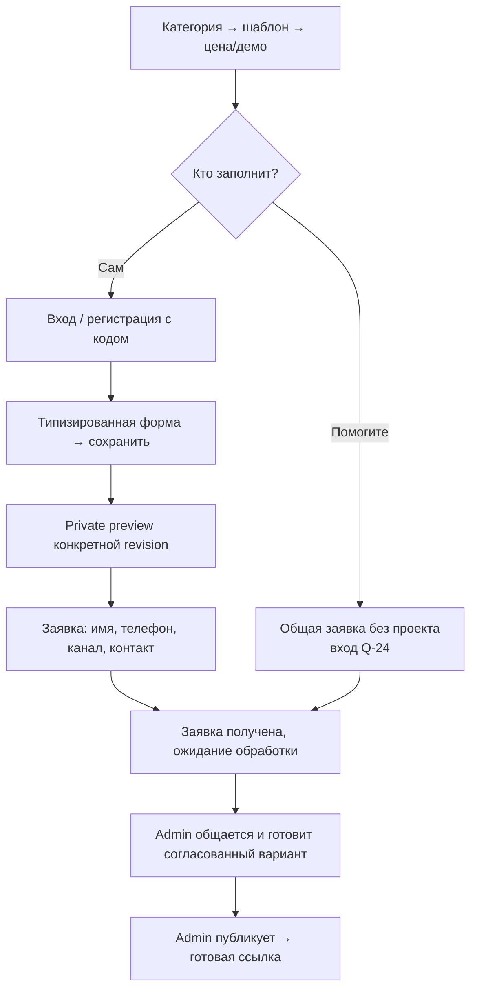
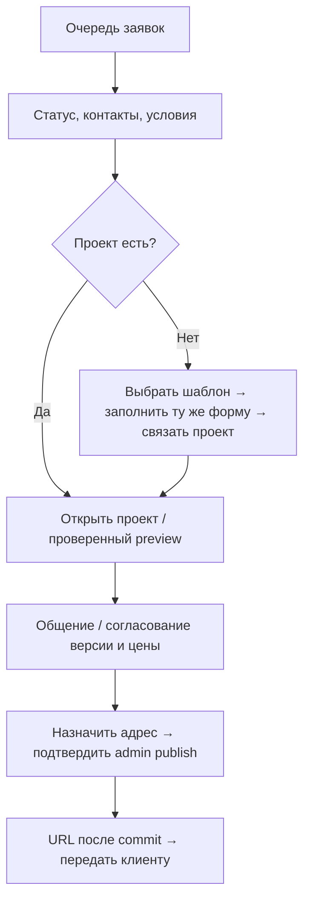

# UX MVP v2 · Клиент, заявка, оператор

Проектирование для ревью, не готовые экраны. [Подтверждённый продукт](../product/mvp-v2.md), [разбор референса](priglashay-reference.md), [API/права](../architecture/assisted-publication.md). Старый HTML self-publish не использовать как текущий flow. Общие Mantine/theme/i18n и оригинальные renderer сохраняются.

## Клиентский путь

На карточке цена относится к шаблону. «Создать своё» сохраняет templateVersion через вход/returnTo, не обещает бесплатную публикацию. Вход не нужен для публичного демо. Цена и категория не являются редактируемыми клиентом полями проекта.

Редактор: фиксированные секции, все контентные тексты/фото по схеме, optional-блоки, отдельные saving/saved/error/conflict. На телефоне форма и preview переключаются без потери ввода; на desktop можно сопоставить их рядом, если макет остаётся читаемым. Смена template не предлагается как свойство существующего проекта. Включение/редактирование после отправки заявки ждёт Q-28.

Preview показывает сохранённую revision и неполноту. Рекомендуемая CTA «Отправить на публикацию» объясняет реальный эффект. В контактной форме имя может начинаться с имени аккаунта, но является отдельным контактным значением. Имя/телефон/канал обязательны по новому поручению; contactValue по Telegram/MAX/VK и пределы ещё Q-32. Ошибки единообразно под полем, noValidate; сеть/лимит/401 — отдельное сообщение без потери ввода. «Цена изменилась»/«Данные обновились» требуют сверки, не молчаливого submit.

Успех заявки содержит её безопасный идентификатор и понятный следующий шаг, без обещания срока ответа/публичного URL. До admin commit нельзя показывать «Сайт опубликован». Проект без аккаунта не получает автоматически клиентский кабинет/непроверенную ссылку на private preview; это Q-24/25.

## Операторский путь

Queue/list/detail должны иметь loading/empty/error/retry, pagination, ясный actor/assignee и состояния. Админский editor использует ту же схему формы/renderer, но отдельные operator routes; UI не подменяет ownerId клиентским параметром. Блок ручной связи показывает канал/контакт; кнопки автоматической отправки/бота не проектируются.

Подтверждение публикации: заявка, шаблон/версия, проверенная revision, согласованная цена, срок по принятой политике, адрес, готовность медиа/RSVP. Поля цены/срока не становятся произвольными override без решения владельца. Дубликат заявки, stale данные, занятое имя, неготовое фото и отказ роли имеют разные сообщения. Во время неопределённого ответа — проверка результата/тот же key, не повтор с новым сроком.

## Соответствие полей

| Экран / значение | Источник данных | Модель / проектируемый API | Приёмка |
| --- | --- | --- | --- |
| Категория/шаблон/цена | Серверный каталог, не пользовательский ввод | TemplateCategory/Template/TemplateVersion; расширение GET templates | FR-01, R2-01/08 |
| Форма Garden и другие | Конкретный DTO по templateVersion | Project payload, существующий save с revision; SQL/JSONB Q-23 не меняет тип формы | FR-06–09, R2-02 |
| Имя/телефон/channel/contactValue | Ввод заказчика, не гостя | ServiceRequest; POST publication-request или service-request по сценарию | R2-03/04/10, Q-32 |
| projectId/submittedRevision | Реальный свой сохранённый проект | Request ↔ Project, server owner check | R2-03/09, Q-28 |
| Actor/assignee/статус заявки | Сервер/admin, не public DTO | Admin request use cases/audit | R2-05/06 |
| Адрес и согласованная версия | Admin после preview, проверка сервера | Admin publish → PublicationVersion/Address/Period | R2-07/08/09 |
| URL готового приглашения | Ответ успешной публикации | Public SSR без контактных полей | FR-13/14, R2-10/11 |

Прежде чем делать HTML/Figma макеты, закрыть относящиеся Q-24/25/27/28/30/32 или показать альтернативы явно. В этом этапе создан UX-текст/схемы, не визуальный UI-kit/финальный макет и не доказательство browser-прохода приложения.
