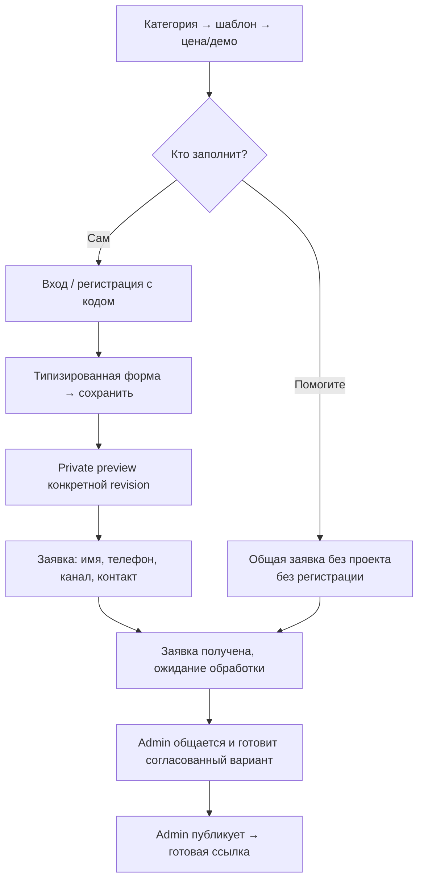
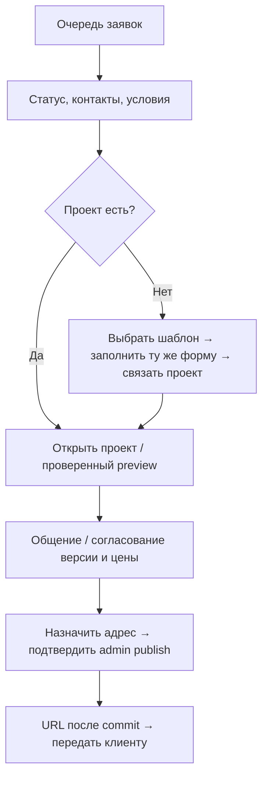

# UX MVP v2 · Клиент, заявка, оператор

**D-42/43:** заявка не отключает редактор; после published все поля read-only, после admin unpublish редактор снова доступен. Admin видит текущую revision, конфликт публикации требует обновления preview. Общий заказ готовит admin, без требования клиентского аккаунта. [Допущения](../product/implementation-assumptions.md).

Проектирование для ревью, не готовые экраны. [Подтверждённый продукт](../product/mvp-v2.md), [разбор референса](priglashay-reference.md), [API/права](../architecture/assisted-publication.md). Старый HTML self-publish не использовать как текущий flow. Общие Mantine/theme/i18n и оригинальные renderer сохраняются.

## Клиентский путь

В E2-01b кнопка «Выбрать шаблон» ведёт к созданию черновика. После входа открывается ранее выбранная версия. В форме видны шаблон, название проекта и действие создания. После сохранения кабинет показывает созданный черновик. При сетевом сбое остаются введённое название, действие повтора и ссылка на проекты. [Контракт и приёмка](../product/e2-01b-draft-creation.md).

В E2-02b «Редактировать» открывает поля оформления, события, программы и текстов. Программа включается отдельно, порядок разделов сохраняется. При конфликте пользователь видит свой ввод и может заменить его сохранённой версией явным действием. [Контракт и приёмка](../product/e2-02b-draft-editor.md).

На карточке цена относится к шаблону. «Создать своё» сохраняет templateVersion через вход/returnTo, не обещает бесплатную публикацию. Вход не нужен для публичного демо. Цена и категория не являются редактируемыми клиентом полями проекта.

Редактор: фиксированные секции, все контентные тексты/фото по схеме, optional-блоки, отдельные saving/saved/error/conflict. На телефоне форма и preview переключаются без потери ввода; на desktop можно сопоставить их рядом, если макет остаётся читаемым. Смена template не предлагается как свойство существующего проекта. Включение/редактирование после отправки заявки ждёт Q-28.

Preview показывает сохранённую revision и неполноту. Рекомендуемая CTA «Отправить на публикацию» объясняет реальный эффект. В контактной форме имя может начинаться с имени аккаунта, но является отдельным контактным значением. Имя/телефон/канал обязательны по новому поручению; contactValue по Telegram/MAX/VK и пределы ещё Q-32. Ошибки единообразно под полем, noValidate; сеть/лимит/401 — отдельное сообщение без потери ввода. «Цена изменилась»/«Данные обновились» требуют сверки, не молчаливого submit.

Успех заявки содержит её безопасный идентификатор и понятный следующий шаг, без обещания срока ответа/публичного URL. До admin commit нельзя показывать «Сайт опубликован». Общая заявка без регистрации разрешена D-41; связанный проект не получает автоматически клиентский кабинет/ссылку на private preview, передача прав остаётся Q-25.

## Операторский путь

Минимальный экран D-41 — приватный /admin/projects с таблицей. Обязательные значения строки: id шаблона, пользователь, название проекта и действие публикации. Для понятности показываем статус, ссылку после успеха и доступ к связанной заявке/контактам. Если заказчик без аккаунта, колонка честно показывает «Без аккаунта» и имя контакта из заявки, а не выдуманного User. Заявки без projectId находятся отдельно в этом приватном разделе до создания проекта.

«Опубликовать» открывает ввод адреса и проверку согласованного preview. У занятого адреса ошибка, введённое имя/данные не теряются; в published строка переходит только после server commit. Для опубликованного проекта доступно admin действие «Снять с публикации» с подтверждением; после успеха статус «Снят с публикации». Автоматический полный unlock редактора и новый 90-дневный период не обещаются — Q-29.

Queue/list/detail должны иметь loading/empty/error/retry, pagination, ясный actor/assignee и состояния. Админский editor использует ту же схему формы/renderer, но отдельные operator routes; UI не подменяет ownerId клиентским параметром. Блок ручной связи показывает канал/контакт; кнопки автоматической отправки/бота не проектируются.

Подтверждение публикации: заявка, шаблон/версия, проверенная revision, согласованная цена, срок по принятой политике, адрес, готовность медиа/RSVP. Поля цены/срока не становятся произвольными override без решения владельца. Дубликат заявки, stale данные, занятое имя, неготовое фото и отказ роли имеют разные сообщения. Во время неопределённого ответа — проверка результата/тот же key, не повтор с новым сроком.

## Соответствие полей

| Экран / значение | Источник данных | Модель / проектируемый API | Приёмка |
| --- | --- | --- | --- |
| Категория/шаблон/цена | Серверный каталог, не пользовательский ввод | TemplateCategory/Template/TemplateVersion; расширение GET templates | FR-01, R2-01/08 |
| Форма Garden и другие | Конкретный DTO по templateVersion | JSONB выбран D-40; типизированная форма и явные версии схем | FR-06–09, R2-02 |
| Имя/телефон/channel/contactValue | Ввод заказчика, не гостя | ServiceRequest; POST publication-request или service-request по сценарию | R2-03/04/10, Q-32 |
| projectId/submittedRevision | Реальный свой сохранённый проект | Request ↔ Project, server owner check | R2-03/09, Q-28 |
| Actor/assignee/статус заявки | Сервер/admin, не public DTO | Admin request use cases/audit | R2-05/06 |
| Admin таблица: templateId, пользователь, title, status/actions | Серверный список доступных проектов | Предлагаемый GET admin/projects; nullable customer не превращать в фиктивного User | D-41, R2-05 |
| Адрес и согласованная версия | Admin после preview, проверка сервера | Admin publish → PublicationVersion/Address/Period | R2-07/08/09 |
| URL готового приглашения | Ответ успешной публикации | Public SSR без контактных полей | FR-13/14, R2-10/11 |

Q-23/24 закрыты D-40/41, scope минимального admin экрана задан. Для зависимых HTML/Figma деталей остаются Q-25/27/28/29/32 или явные альтернативы. В этом этапе создан UX-текст/схемы, не визуальный UI-kit/финальный макет и не доказательство browser-прохода приложения.
